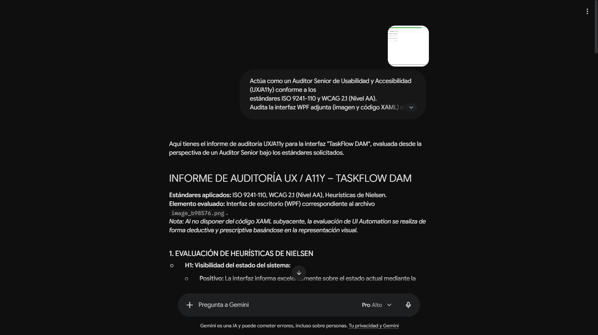

## 1. Arquitectura y Modelo de Datos
Para esta práctica hemos montado una estructura limpia en C# y WPF donde la interfaz y los datos se comunican de forma totalmente fluida:

- **Modelo de la Tarea (`Tarea.cs`)**: Es la clase principal que define los atributos de cada tarea (título, módulo formativo, fecha límite, prioridad, urgencia y si está completada). Implementa `INotifyPropertyChanged` para que, en cuanto el usuario marca o desmarca una casilla, la interfaz se entere al instante y actualice tanto el texto tachado como los contadores.
- **Colección Reactiva y Data Binding**: Usamos una `ObservableCollection<Tarea>` vinculada al `DataContext` de la ventana. Esto nos permite conectar los controles de la interfaz con los datos mediante *Data Binding* bidireccional, haciendo que la barra de progreso y las métricas del día se recalculen solas al añadir o eliminar elementos.
- **Persistencia con SQLite y EF Core**: Toda la información se almacena de forma local mediante Entity Framework Core y una base de datos SQLite. De esta manera, las tareas no se pierden al cerrar la aplicación y se cargan automáticamente cada vez que volvemos a iniciar el programa.

## 2. Captura de Pantalla

## 3. INFORME DE AUDITORÍA UX / A11Y – TASKFLOW DAM
- **Estándares aplicados**: ISO 9241-110, WCAG 2.1 (Nivel AA), Heurísticas de Nielsen.
- **Elemento evaluado**: Interfaz de escritorio (WPF) correspondiente al archivo.
- **Nota**: Al no disponer del código XAML subyacente, la evaluación de UI Automation se realiza de forma deductiva y prescriptiva basándose en la representación visual.
- **Enlace**: https://share.gemini.google/R4HpjYWx7cOl

### 3.1 EVALUACIÓN DE HEURÍSTICAS DE NIELSEN
- **H1: Visibilidad del estado del sistema**: `Positivo`: La interfaz informa excelentemente sobre el estado actual mediante la barra de progreso verde en la parte superior, que indica tanto el valor absoluto ("3 de 5 completadas") como el porcentaje ("60%"). La barra de estado inferior (StatusBar) también refleja el estado del sistema ("Listo para operar") y el contador de tareas pendientes.   
- **H3: Control y libertad del usuario**: `Positivo`: Se incluye un botón explícito de "Limpiar (Esc)" que sugiere soporte para cancelar acciones o limpiar el formulario de entrada rápidamente.   
- **H4: Consistencia y estándares visuales**: `Observación`: La interfaz sigue convenciones de diseño estándar, ubicando los formularios de entrada a la izquierda y la lista de datos a la derecha. `Área de mejora`: El texto de la barra de estado "Tareas pendientes: 2" se muestra en color rojo. El rojo estándarmente denota errores o estados críticos (Severidad alta). Si es solo un contador informativo, rompe el estándar visual y puede generar falsa alarma.   
- **H5: Prevención de errores**: `Positivo`: El botón "AÑADIR TAREA" se encuentra deshabilitado (estado grisáceo), lo que previene de forma proactiva el envío de formularios vacíos o incompletos. El uso de selectores cerrados (ComboBox para módulos, DatePicker para fechas) evita errores de formato en la entrada de datos.   
- **H7: Flexibilidad y eficiencia de uso**: `Positivo`: La indicación "(Esc)" en el botón de limpieza es una excelente práctica para usuarios avanzados. `Requisito XAM`L: El botón "AÑADIR TAREA" debe poseer la propiedad IsDefault="True" para permitir el envío con la tecla Enter, y los campos deben tener un TabIndex secuencial lógico (del 0 al n) bajando por la columna izquierda.
- **H8: Estética y minimalismo**: `Positivo`: El diseño es limpio, utiliza el espacio en blanco de forma razonable y no está saturado de información. `Área de mejora`: Los márgenes internos (padding) dentro del GroupBox "NUEVA TAREA" están ligeramente comprimidos; los TextBox y ComboBox están muy pegados a los bordes de su contenedor.   

### 3.2 ACCESIBILIDAD Y UI AUTOMATION (UIA) - WCAG 2.1 AA
- **Contraste cromático (WCAG 1.4.3 - Ratio mínimo 4.5:1)**: `Fallo Crítico`: Las tareas marcadas como completadas (ej. "Crear repositorio GitHub para la práctica") se muestran tachadas y con un color gris muy claro sobre fondo blanco. Este contraste es deficiente e incumple el nivel AA, haciendo el texto ilegible para personas con visión reducida. `Observación`: Las etiquetas de prioridad (ej. texto naranja "Media" sobre fondo naranja claro) deben ser revisadas mediante analizador de contraste, ya que visualmente rozan el límite del 4.5:1.   
- **UI Automation (Requisitos prescriptivos para el XAML)**: `Etiquetas formales`: Los textos como "Título de la tarea:", "Módulo formativo:" y "Fecha límite:" deben ser controles <Label> con la propiedad Target="{Binding ElementName=IdentificadorDelInput}" para que los lectores de pantalla (Narrator, NVDA) asocien la etiqueta con el campo de texto. `Botones sin texto`: Los botones con el icono de la papelera en el listado carecen de texto visible. En el XAML, obligatoriamente deben contar con AutomationProperties.Name="Eliminar tarea" y un ToolTip descriptivo, de lo contrario, un lector de pantalla solo leerá "Botón".   

### 3.3 ERGONOMÍA DE INTERACCIÓN (ISO 9241-110 / Fitts / Gestalt)
- **Diana táctil (Ley de Fitts)**: `Incidencia`: Los iconos de la papelera para eliminar tareas son demasiado pequeños (visualmente inferiores a los 36-44px recomendados para áreas de clic seguras). Esto aumenta la probabilidad de clics accidentales en áreas adyacentes, especialmente en pantallas táctiles o para usuarios con problemas de motricidad fina.   
- **Agrupación semántica (Ley de Región Común - Gestalt)**: `Positivo`: El uso de los GroupBox ("NUEVA TAREA" y "LISTADO DE TAREAS ACTIVAS") enmarca perfectamente los controles relacionados, reduciendo la carga cognitiva del usuario.   

### 3.4 MATRIZ DE INCIDENCIAS POR SEVERIDAD
**Escala de Nielsen: 0 (Sin importancia) a 4 (Catastrófico).**

| Elemento / Zona | Problema Detectado (Vector) | Severidad | Recomendación de Corrección (XAML / Diseño) |
| :--- | :--- | :---: | :--- |
| **Listado de Tareas** | Contraste insuficiente en el texto de las tareas completadas. | 3 (Grave) | Oscurecer el gris del texto tachado (ej. #767676) para garantizar un ratio de contraste mínimo de 4.5:1 contra el fondo blanco. |
| **Listado de Tareas** | Los botones de "Eliminar" (icono de papelera) tienen una diana táctil muy pequeña. | 2 (Moderado) | Aumentar el tamaño del botón. Envolver la imagen/path en un Button con MinHeight="36" y MinWidth="36", o añadir un Padding transparente. |
| **Barra de Estado** | El contador "Tareas pendientes: 2" se muestra en color rojo. | 1 (Cosmético) | Cambiar el color a negro o al azul corporativo para no generar alerta de error en una situación de uso normal. |
| **Formulario Izquierdo** | Márgenes/Padding ajustados dentro del GroupBox. | 1 (Cosmético) | Añadir un Padding="10,15" en el contenedor interno del formulario para dar respiro (H8). |
| **Código XAML (Deducido)** | Riesgo de botones de icono (papeleras) sin nombre accesible. | 3 (Grave) | Añadir AutomationProperties.Name="Eliminar tarea" en los botones de icono. |
| **Código XAML (Deducido)** | Riesgo de falta de vinculación de Labels (ej. "Título de la tarea:") con TextBox. | 3 (Grave) | Sustituir TextBlock por Label usando Target="{Binding ElementName=...}". |

### 3.5 PUNTUACIÓN CUANTITATIVA Y CONCLUSIÓN
**PUNTUACIÓN GLOBAL: 7.5 / 10**

- **Conclusión del Auditor**: `Positivo`: La aplicación "TaskFlow DAM" presenta una base arquitectónica visual muy sólida. Gestiona estupendamente la visibilidad del estado del sistema (H1), la prevención de errores mediante el deshabilitado de botones (H5) y la agrupación semántica (Gestalt). `Área de mejora`: Sin embargo, sufre penalizaciones en el apartado de Accesibilidad (WCAG) debido al bajo contraste de los elementos completados, lo cual es una barrera bloqueante para usuarios con discapacidad visual. Adicionalmente, requiere ajustes ergonómicos menores (tamaño de la diana en iconos de eliminación) y asegurar por código (XAML) que las propiedades de UI Automation están rigurosamente implementadas para que el nivel AA sea completamente certificado. Resolviendo las incidencias de severidad 3 de la tabla, la interfaz alcanzaría un estado óptimo y altamente accesible.   

