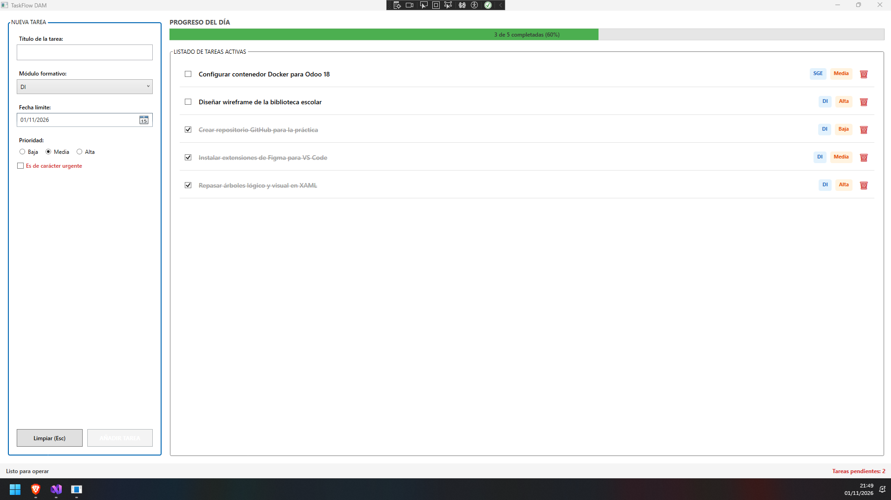

## 1. Arquitectura y Modelo de Datos
Para esta práctica hemos montado una estructura limpia en C# y WPF donde la interfaz y los datos se comunican de forma totalmente fluida:

- **Modelo de la Tarea (`Tarea.cs`)**: Es la clase principal que define los atributos de cada tarea (título, módulo formativo, fecha límite, prioridad, urgencia y si está completada). Implementa `INotifyPropertyChanged` para que, en cuanto el usuario marca o desmarca una casilla, la interfaz se entere al instante y actualice tanto el texto tachado como los contadores.
- **Colección Reactiva y Data Binding**: Usamos una `ObservableCollection<Tarea>` vinculada al `DataContext` de la ventana. Esto nos permite conectar los controles de la interfaz con los datos mediante *Data Binding* bidireccional, haciendo que la barra de progreso y las métricas del día se recalculen solas al añadir o eliminar elementos.
- **Persistencia con SQLite y EF Core**: Toda la información se almacena de forma local mediante Entity Framework Core y una base de datos SQLite. De esta manera, las tareas no se pierden al cerrar la aplicación y se cargan automáticamente cada vez que volvemos a iniciar el programa.

